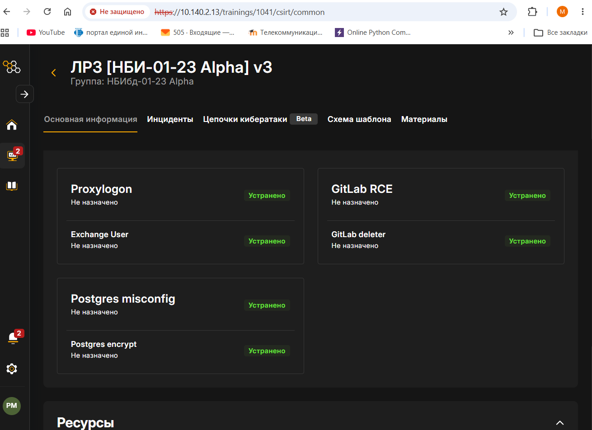

# Отчёт по лабораторной работе 3

Защита корпоративных ресурсов: расследование учебной атаки в Ampire и устранение последствий на Microsoft Exchange, GitLab и PostgreSQL.

**[Исходник Markdown](report/report.md)** · **[Готовый PDF](report/_output/report.pdf)** · **[Готовый Word](report/_output/report.docx)**

Выполнили Рогозин Игорь, Гусейнов Тагир и Райко Матвей, группа НБИбд-01-23. Дата выполнения — 14 октября 2026 года. Тренировка № 1041 «ЛР3 [НБИ-01-23 Alpha] v3».

## Структура

```text
lr3-blue-team-ampire-report/
├── README.md
├── Makefile                      сборка из корня репозитория
├── build.ps1                     запуск из PowerShell
└── report/
    ├── report.md                 единственный исходник текста
    ├── Makefile                  Pandoc → DOCX и XeLaTeX → PDF
    ├── image/                    45 рисунков
    ├── bib/                      каталог библиографии шаблона
    ├── pandoc/
    │   ├── metadata.yaml         настройки форматов и подписей
    │   ├── layout.lua            титул, содержание и границы разделов
    │   ├── tables.lua            оформление таблиц PDF
    │   ├── header.tex            оформление PDF
    │   ├── title.tex             титульная страница PDF
    │   ├── reference.docx        стили Word
    │   ├── finalize_docx.py      оформление и диапазоны страниц Word
    │   ├── export-word.ps1       пагинация Word в Windows
    │   ├── install-tools.sh      установка закреплённых версий
    │   └── requirements.txt      зависимости Python
    └── _output/
        ├── report.pdf
        └── report.docx
```

Редактируйте `report/report.md`. Изображения и подписи находятся в том же исходнике; номера разделов, рисунков и таблиц формируются при сборке. В PDF и Word содержание содержит кликабельные диапазоны страниц. Список источников в отчёт не включён.

## Подготовка инструментов

Проверенная связка: **Pandoc 3.8.2**, **pandoc-crossref 0.3.22**, XeLaTeX из TeX Live. Версия Pandoc совпадает с версией, с которой собран фильтр. Сборка использует [Pandoc](https://pandoc.org/MANUAL.html), [pandoc-crossref](https://lierdakil.github.io/pandoc-crossref/) и GNU Make.

Для Linux или Ubuntu в WSL установите зависимости:

```bash
sudo apt-get update
sudo apt-get install -y make curl ca-certificates python3-venv python3-pip \
  texlive-xetex texlive-lang-cyrillic texlive-latex-extra texlive-fonts-recommended \
  lmodern fonts-liberation2 fonts-dejavu-core libreoffice-writer

sh report/pandoc/install-tools.sh
export PATH="$HOME/.local/bin:$PATH"
python3 -m venv .venv
. .venv/bin/activate
python -m pip install -r report/pandoc/requirements.txt
make check
```

На Windows рекомендуется выполнять эти команды в Ubuntu WSL. Нативная сборка тоже возможна при наличии `make`, Pandoc, фильтра, XeLaTeX, Python и Microsoft Word. Для финализации Word требуются пакеты из `requirements.txt`. В Linux пагинацию выполняет LibreOffice, в Windows — установленный Microsoft Word.

## Сборка

Из корня репозитория:

```bash
make             # оба формата
make pdf         # только PDF
make docx        # только Word
make versions    # версии инструментов
```

Из папки отчёта действует та же команда:

```bash
cd report
make
```

Из PowerShell после подготовки инструментов:

```powershell
.\build.ps1 -Format all
.\build.ps1 -Format pdf
.\build.ps1 -Format docx
```

Результаты записываются в `report/_output/report.pdf` и `report/_output/report.docx`. После изменения исходника запустите `make` повторно. Для принудительной пересборки используйте `make -B all`. `make clean` удаляет только скомпилированные результаты; исходник и рисунки остаются.

Рецепты сборки останавливаются при ошибке. Неудачно созданный выходной файл удаляется, поэтому частичная сборка не выдаётся за готовый отчёт. `README.md` не компилируется вместе с отчётом.

## Результаты лабораторной работы

| Актив | Выполненные действия | Проверка |
| :--- | :--- | :--- |
| Exchange | Ограничение ECP, удаление нелегитимного пользователя и завершение атакующего процесса | `hacker` отсутствует; прежние процессы и соединения не наблюдаются |
| GitLab | Восстановление проекта, обновление до CE 13.10.3 и одобрение регистраций администратором | `README.md` и `main.py` доступны; все 15 служб запущены |
| PostgreSQL | Восстановление файлов, смена пароля, ограничение HBA и переход на `localhost` | Четыре файла, `diff` без различий, удалённый 5432 недоступен |


