<a id="introduction"></a>

# Введение {#introduction}

В лабораторной работе мы исследовали учебную атаку на внутренние корпоративные ресурсы в полигоне Ampire. Нарушитель последовательно воздействовал на почтовый сервер Microsoft Exchange, сервер разработки GitLab и сервер PostgreSQL. Последствиями стали появление нелегитимного локального администратора, удаление содержимого репозитория и шифрование важных файлов.

Мы сопоставили события сетевого сенсора с состоянием хостов, сохранили материалы расследования, восстановили данные и изменили настройки доступа. Итоговый экран тренировки показывает устранение всех трех уязвимостей и трех последствий.

<a id="goal"></a>

## Цель работы {#goal}

Установить последовательность и технические признаки атаки на корпоративные ресурсы, устранить выявленные причины и последствия в пределах учебного сценария, а затем проверить результат по состоянию сервисов, данных и интерфейсу тренировки.

<a id="tasks"></a>

## Задачи {#tasks}

Изучить легенду и схему стенда, определить атакованные активы и источник подозрительной активности.

Найти события Exchange, GitLab и PostgreSQL в ViPNet IDS NS и сохранить сведения о правилах обнаружения.

Сопоставить сетевые события, отдельные пакеты и журналы приложений, отделив попытки действий от подтвержденных последствий.

Ограничить доступ к ECP, удалить нелегитимную учетную запись и завершить подтвержденные атакующие сеансы на Exchange.

Восстановить проект GitLab, обновить пакет и ограничить создание новых учетных записей.

Восстановить зашифрованные файлы PostgreSQL, изменить пароль и конфигурацию сетевого доступа.

Зафиксировать три инцидента и сопоставить итоговые статусы платформы с выполненными действиями.

<a id="environment"></a>

# Сценарий и используемый стенд {#environment}

Работа выполнялась в тренировке «ЛР3 [НБИ-01-23 Alpha] v3», идентификатор 1041, группа «НБИбд-01-23 Alpha». Тренировка запущена 14 октября 2026 года в 15:27. По легенде сотрудник перед увольнением решил причинить ущерб организации и атаковал доступные ему внутренние ресурсы.

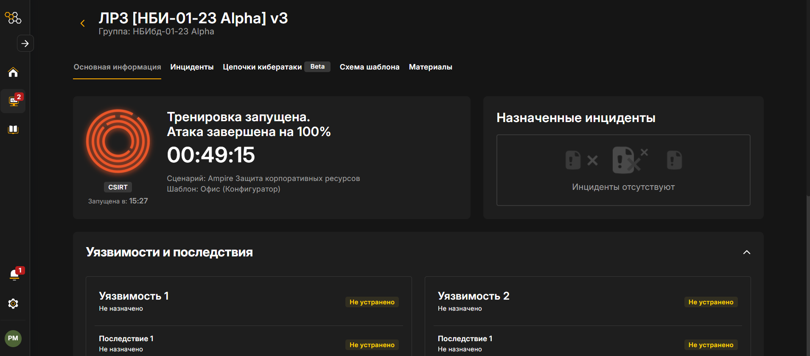{#fig:01 width=16.40cm}

Исходный экран показывает, что атака уже завершена. Поэтому в работе исследовались ее следы и последствия. Мы не запускали повторную эксплуатацию для воспроизведения ущерба.


| Узел | Адрес | Назначение |
| :--- | :--- | :--- |
| Insider | `10.10.4.55` | Источник атакующей активности по легенде и сетевым событиям |
| MS Exchange / MAIL | `10.10.2.11` | Почтовый сервер и приложение ECP в IIS |
| GitLab / ampire-gitlab | `10.10.2.18` | Сервер разработки и репозиторий `Very sensitive project` |
| PostgreSQL / postgrdeb | `10.10.2.26` | Сервер БД и каталог важных файлов |
| ViPNet IDS NS | `10.10.2.21` | Сетевой сенсор обнаружения атак |
| Internal Router | `10.10.2.254` | Маршрутизатор, адрес которого присутствует в части наблюдений |
| Active Directory | `10.10.2.10` | Инфраструктурные службы стенда |

: Основные узлы учебного стенда {#tbl:1}

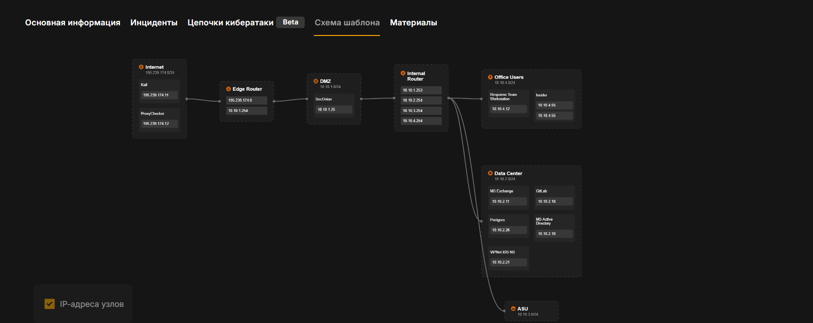{#fig:02 width=16.40cm}

Сеть стенда отделена от адресов подключения к учебной инфраструктуре. В частности, `10.140.2.133` использовался как удаленная рабочая станция, а веб-интерфейс Ampire был доступен по адресу `10.140.2.13`. В таблице приведены внутренние адреса, по которым сопоставлялись события и состояние активов.

Времена в интерфейсе IDS и журналах сопоставлялись с московским временем. Имена выгруженных PCAP содержат отметку UTC: например, 12:29:14Z соответствует 15:29:14 по Москве. Это различие учитывалось при восстановлении хронологии.

<a id="theory"></a>

# Краткие теоретические сведения {#theory}

<a id="proxylogon"></a>

## ProxyLogon и ограничение доступа к ECP {#proxylogon}

В сценарии Exchange используется цепочка ProxyLogon: SSRF `CVE-2021-26855` сочетается с `CVE-2021-27065`, связанной с записью файла. ECP является административным веб-приложением Exchange и участвует в этой цепочке. Методические указания предлагают ограничить доступ к `/ecp`, затем устранить активные соединения и созданного пользователя.

Ограничение административного URL уменьшает доступную поверхность атаки. Его следует отличать от установки исправлений и проверки уже скомпрометированной системы: Microsoft рассматривает временные меры как дополнение к обновлению, а не как подтверждение полной очистки сервера.

<a id="gitlab-vulnerability"></a>

## Уязвимость обработки изображений в GitLab {#gitlab-vulnerability}

`CVE-2021-22205` относится к удаленному выполнению команд при обработке загружаемых изображений в GitLab. В рассматриваемой цепочке задействован сторонний обработчик ExifTool; связанная с ним уязвимость обозначается `CVE-2021-22204`. Поэтому в событиях сенсора встречаются оба идентификатора, относящиеся к разным уровням цепочки.

GitLab указывает версию `13.10.3` среди выпусков, содержащих исправление `CVE-2021-22205`. Именно она использовалась как целевая версия в данной лабораторной работе. Перед обновлением требовалось восстановить удаленные данные из резервной копии, подходящей к исходной версии и редакции.

<a id="postgres-privileges"></a>

## Привилегированный доступ и COPY FROM PROGRAM {#postgres-privileges}

Команда `COPY FROM PROGRAM` запускает указанную программу на стороне сервера PostgreSQL. В PostgreSQL 13 такой доступ ограничен суперпользователями и соответствующими привилегированными ролями. Следовательно, существенным условием рассматриваемой атаки был доступ к привилегированной роли в сочетании с чрезмерно широким сетевым доступом.

В сенсоре и методичке этот этап связан с `CVE-2019-9193` и обозначен как Postgres misconfig. Практические меры направлены на устранение небезопасной конфигурации: ограничение прослушиваемых адресов и правил `pg_hba.conf`, смену пароля и прекращение нежелательных сеансов. Само наличие функции COPY не означает возможность ее вызова любым непривилегированным клиентом.

<a id="detection"></a>

# Обнаружение и восстановление последовательности атаки {#detection}

<a id="ids-events"></a>

## Работа с событиями ViPNet IDS NS {#ids-events}

В разделе «События» ViPNet IDS NS были найдены срабатывания по трем атакованным активам. Для разделения этапов использовался фильтр «Получатель → IP-адрес». В списке сопоставлялись время, имя правила, адреса и порты; в карточке события проверялись код и класс правила.

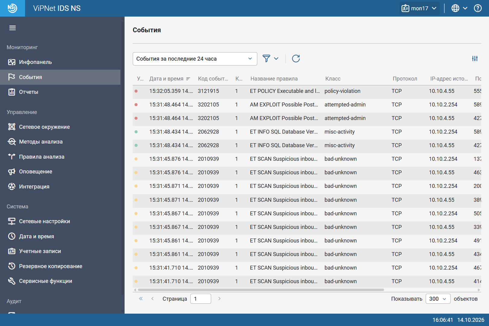{#fig:03 width=16.40cm}

Для каждого актива сохранены общий список релевантных событий и подробности одного характерного срабатывания. Такая пара позволяет связать контекст сетевой активности с конкретной сигнатурой, не подменяя расследование одним названием правила.

<a id="exchange-events"></a>

## События атаки на Exchange {#exchange-events}

При фильтрации по получателю `10.10.2.11` обнаружены события загрузки исполняемого файла и характерной активности Metasploit. Время 15:28:34 предшествует этапам GitLab и PostgreSQL. В наблюдаемом обмене фигурируют источник `10.10.4.55:5556` и порты 7449/7450 на Exchange.

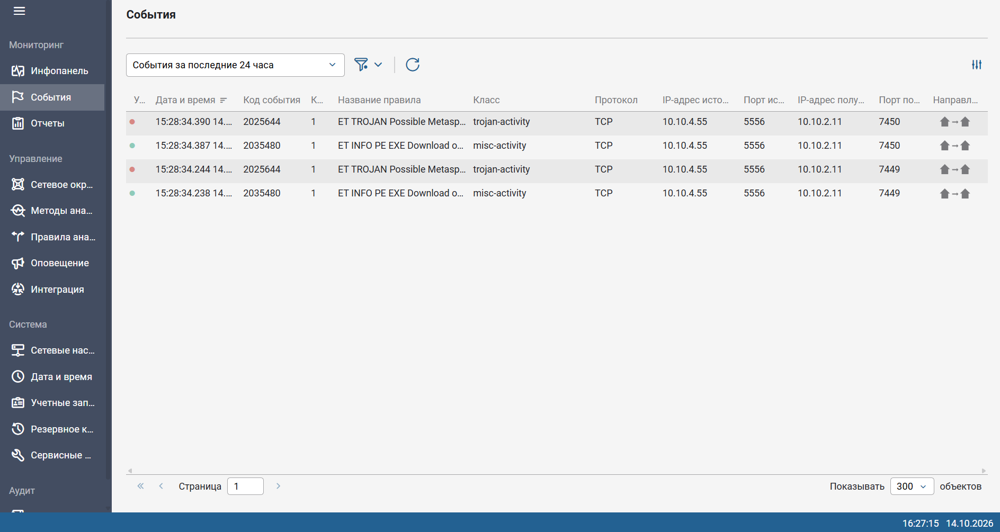{#fig:04 width=16.40cm}

В подробностях события 15:28:34.390 указано правило «ET TROJAN Possible Metasploit Payload Common Construct Bind_API (from server)», код 2025644, класс trojan-activity. Это сетевой признак вредоносной нагрузки; сведения о созданной учетной записи проверялись отдельно на самом сервере.

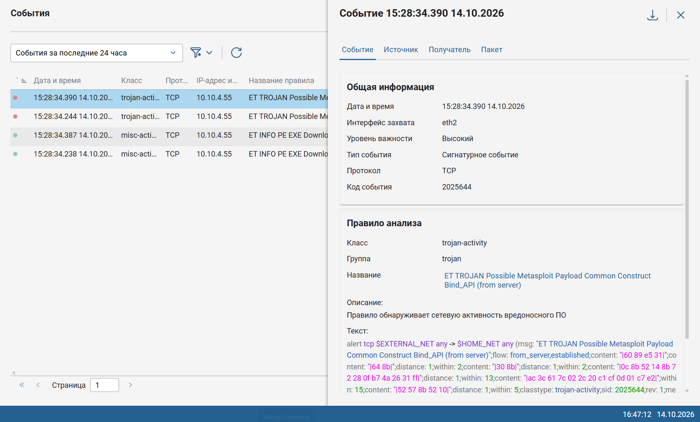{#fig:05 width=16.40cm}

<a id="gitlab-events"></a>

## События атаки на GitLab {#gitlab-events}

Для `10.10.2.18` в 15:29:14 найдены срабатывания на обработку изображения ExifTool, внедрение команд и загрузку ELF-файла. Сочетание событий указывает на этап выполнения команд с последующим получением исполняемой нагрузки.

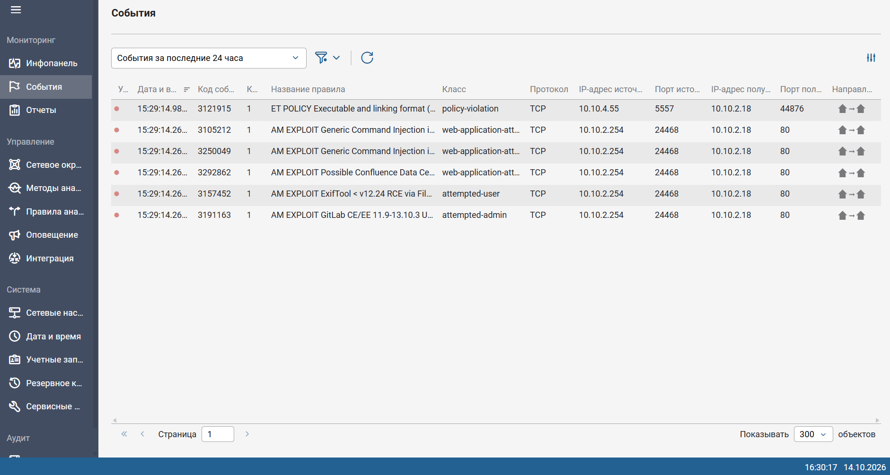{#fig:06 width=16.40cm}

Характерное событие 15:29:14.264 имеет код 3191163 и имя «AM EXPLOIT GitLab CE/EE … Unauthenticated Remote ExifTool Command Injection (`CVE-2021-22205`)». В сетевом наблюдении источником HTTP-запроса является `10.10.2.254`. Это фактически наблюдаемый адрес; механизм преобразования адресов дополнительно не проверялся.

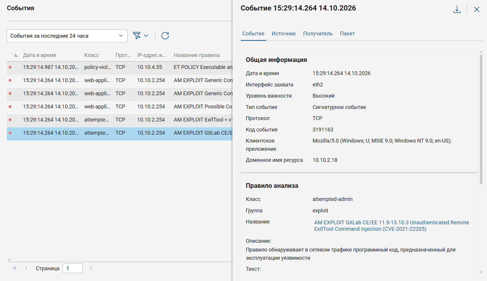{#fig:07 width=16.40cm}

<a id="postgres-events"></a>

## События атаки на PostgreSQL {#postgres-events}

При фильтрации по `10.10.2.26` видны обнаружение версии СУБД, сканирование порта 5432, признаки `COPY FROM PROGRAM` и загрузка ELF. Событие 15:31:48.464 имеет код 3202105; правило относит активность к попытке получения административного доступа.

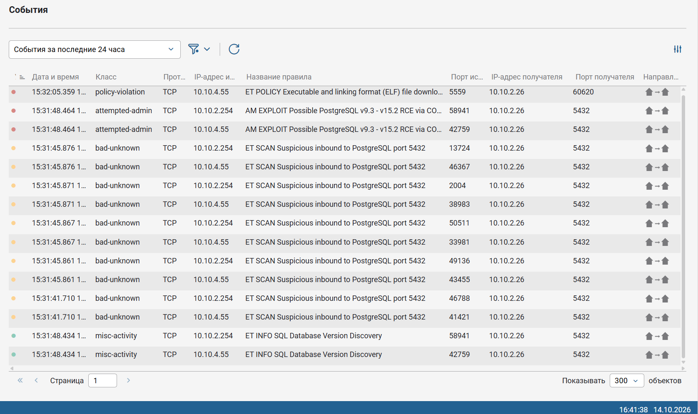{#fig:08 width=16.40cm}

Полное имя выбранной сигнатуры содержит «AM EXPLOIT Possible PostgreSQL v9.3 - v15.2 RCE via `COPY FROM PROGRAM` (`CVE-2019-9193`, `CVE-2022-31659`)». Идентификаторы из имени правила использовались как ориентир расследования. Реальные выполненные команды и их результат проверялись по журналу PostgreSQL и файлам на хосте.

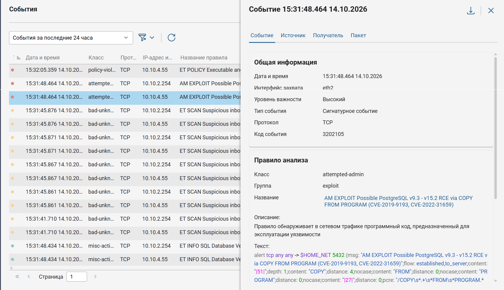{#fig:09 width=16.40cm}

<a id="attack-timeline"></a>

## Хронология и сопоставление источников {#attack-timeline}


| Время МСК | Актив | Наблюдение | Подтверждение |
| :--- | :--- | :--- | :--- |
| 15:28:34 | Exchange | Обмен с `10.10.4.55:5556`, признаки Metasploit | IDS; позднее обнаружены соответствующие PowerShell-соединения |
| 15:29:14.264 | GitLab | Загрузка изображения с командной нагрузкой | Правило 3191163 и отдельный HTTP-пакет |
| 15:29:14 | GitLab | Процесс `/tmp/idMnwN` от пользователя git | Состояние процесса и TCP-соединение на 5557 |
| 15:31:48.464 | PostgreSQL | Команда `COPY FROM PROGRAM` | Правило 3202105, отдельный SQL-пакет и журнал |
| 15:32:05.359 | PostgreSQL | Передача части ELF-файла | Правило 3121915 и отдельный пакет |
| 15:32:19 | PostgreSQL | Запуск закодированного скрипта через `hacker_table` | Записи журнала и зашифрованный архив |

: Ключевые моменты атаки 14 октября 2026 года {#tbl:2}

Из IDS выгружены три PCAP с отдельными пакетами: SQL-командой к PostgreSQL, фрагментом ELF и запросом загрузки изображения в GitLab. Это фрагменты обмена, а не полный сетевой сеанс. По ним подтверждаются адреса, порты и содержимое отдельных сообщений; они не доказывают успех всех последующих действий.

В HTTP-пакете GitLab использован POST `/gitlab/uploads/user`. Файл `4RnGPh.jpg` содержал данные DjVu и командную нагрузку, связанную с запуском `/tmp/idMnwN`. В SQL-пакете зафиксирован вызов `COPY FROM PROGRAM` с попыткой обратного подключения на `10.10.4.55:5558`. Сопоставление с журналом показало для этой попытки ошибку Bash «`Bad file descriptor`», поэтому успешная интерактивная оболочка по этому эпизоду не утверждается.

<a id="host-investigation"></a>

# Расследование и устранение на хостах {#host-investigation}

<a id="exchange-remediation"></a>

## Microsoft Exchange {#exchange-remediation}

На сервере MAIL обнаружен локальный пользователь `hacker`. Во вкладке `Member Of` его свойств указана группа `Administrators`. Таким образом, последствие Exchange User подтверждается состоянием учетной записи на самом хосте, а не только легендой тренировки.

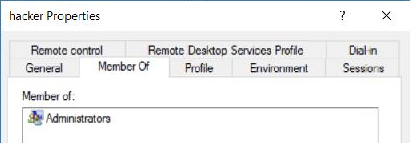{#fig:10 width=16.40cm}

В Resource Monitor обнаружены два процесса `powershell.exe` с PID 14552 и 14576. Их соединения `10.10.2.11:7449/7450` → `10.10.4.55:5556` совпадают с парой портов из событий IDS. Это позволило выбрать конкретные процессы для завершения, не затрагивая остальные сеансы PowerShell и штатные службы Exchange.

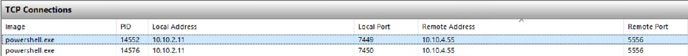{#fig:11 width=16.40cm}

В IIS Manager открыт путь MAIL → Sites → `Default Web Site` → ecp → `IP Address and Domain Restrictions`. В `Edit Feature Settings` значение `Access for unspecified clients` изменено на `Deny` и сохранено. Настройка повторно открыта для проверки. Тип ответа `Deny Action Type` оставлен `Not Found`, как в примере методички; отдельных разрешающих IP-правил в списке не было.

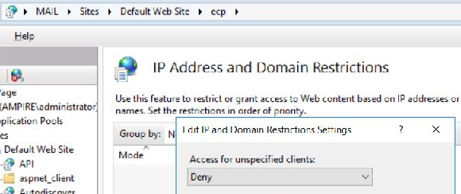{#fig:12 width=16.40cm}

Для подтвержденного атакующего процесса выполнено `End Process`. После возобновления мониторинга PID 14552 и 14576 отсутствовали в обновленном списке процессов. В TCP-таблице, отсортированной по `Remote Address`, соединений с `10.10.4.55` больше не наблюдалось.

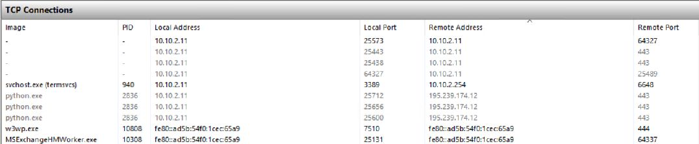{#fig:13 width=16.40cm}

Пользователь `hacker` удален через оснастку `Local Users and Groups`. После подтверждения удаления список обновлен клавишей F5. В нем остаются `Administrator`, `DefaultAccount`, frunklin, Guest и John; `hacker` отсутствует.

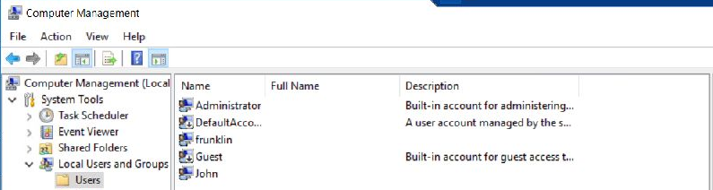{#fig:14 width=16.40cm}

Для Exchange подтверждены ограничение ECP, удаление нелегитимного администратора и отсутствие прежних атакующих соединений на момент проверки. Отдельный внешний HTTP-тест запрета ECP и проверка установленного пакета исправлений не выполнялись.

<a id="gitlab-remediation"></a>

## GitLab {#gitlab-remediation}

Работа с GitLab выполнялась на хосте ampire-gitlab, `10.10.2.18`. Исходно использовалась редакция Enterprise Edition версии `13.10.2-ee.0`. В процессах найден `/tmp/idMnwN` с PID 2697, запущенный от пользователя git в 15:29:14, что согласуется со временем загрузки из сетевого события.

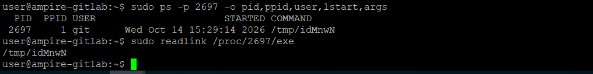{#fig:15 width=16.40cm}

Перед завершением процесса он был приостановлен, а исполняемый файл сохранен через `/proc/2697/exe` в каталоге `/home/user/lr3-gitlab-evidence`. Вместе с ним сохранены журналы nginx и `gitlab-rails`, конфигурация `gitlab.rb`, файл `gitlab-secrets.json` и стабильная резервная копия. Доступ к собранным материалам ограничен. Для сохраненного бинарного файла вычислена SHA-256; ее значение приведено в [приложении Б](#appendix-files).

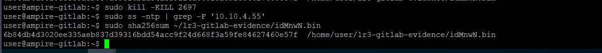{#fig:16 width=16.40cm}

После сохранения доказательств процесс завершен. Проверка ss по адресу `10.10.4.55` вернула пустой вывод. Соединение с данным адресом на момент проверки отсутствовало.

В веб-интерфейсе проект `Very sensitive project` существовал, однако его репозиторий был пуст. Это соответствует последствию GitLab deleter. Для восстановления использована `stable_gitlab_backup.tar`, подготовленная для исходной версии `13.10.2-ee`.

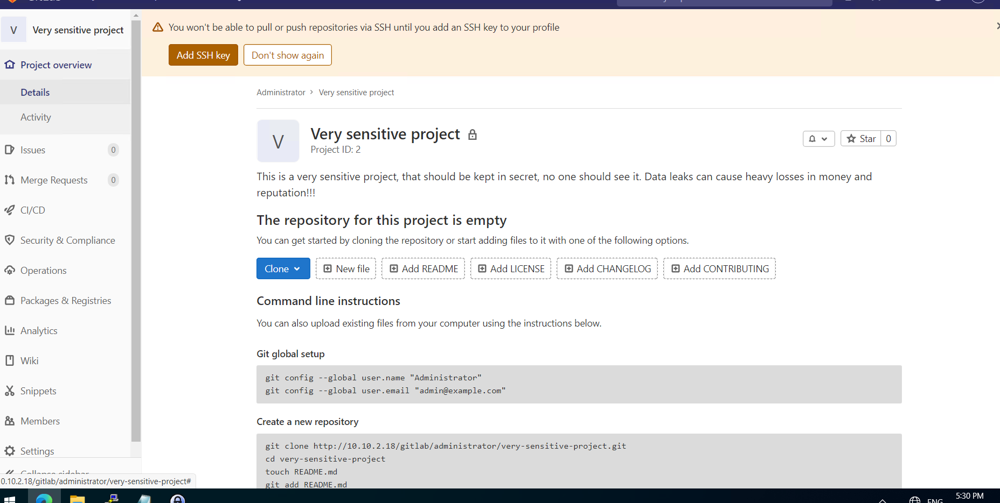{#fig:17 width=16.40cm}

Перед восстановлением остановлены Puma и Sidekiq. Затем запущено восстановление стабильной копии. Такой порядок сохраняет соответствие версии приложения и формата резервной копии: сначала восстанавливаются данные исходной установки, затем выполняется обновление пакета.

```bash
sudo gitlab-ctl stop puma
sudo gitlab-ctl stop sidekiq
sudo gitlab-backup restore BACKUP=stable
sudo gitlab-ctl reconfigure
sudo gitlab-ctl restart
```

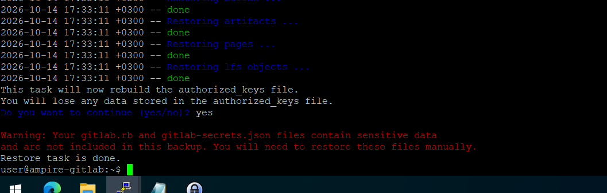{#fig:18 width=16.40cm}

После восстановления и перезапуска службы находились в состоянии `run`, а в проекте появились `README.md` и `main.py`. В ветке `master` видны восстановленные коммиты. Дополнительно перед обновлением была создана свежая резервная копия `1791989995_2026_10_14_13.10.2-ee_gitlab_backup.tar`; первая операция завершилась сообщением `Backup task is done`.

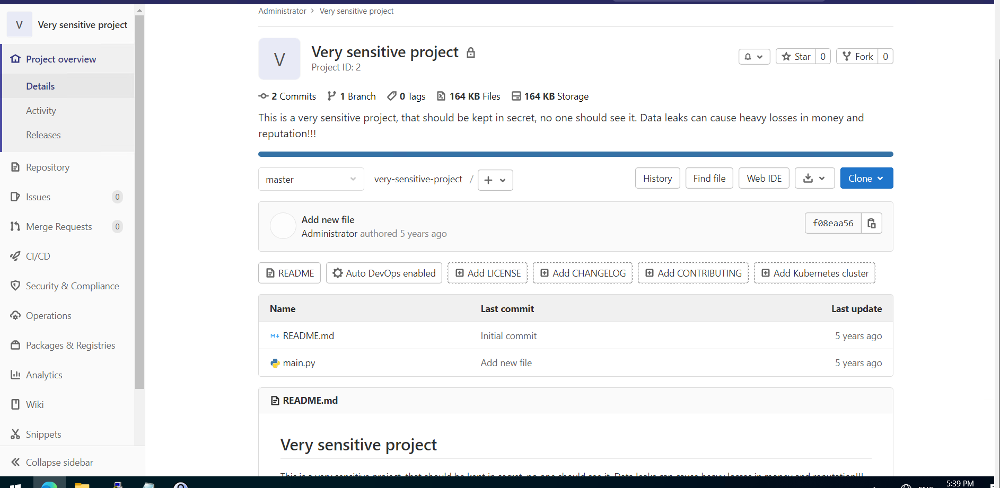{#fig:19 width=16.40cm}

Обновление выполнено локальным пакетом `gitlab-ce_13.10.3-ce.0_amd64.deb` из учебного каталога обновлений. Перед установкой проверены имя пакета, версия и архитектура: `gitlab-ce`, `13.10.3-ce.0`, amd64. Использование локального пакета позволило выполнить этап при недоступных внешних репозиториях.

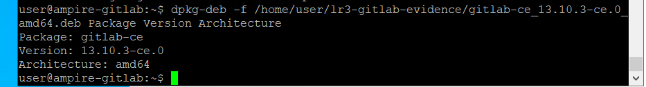{#fig:20 width=16.40cm}

Поскольку пакет менял редакцию EE на CE, предварительно проверены используемые возможности: Kerberos выключен, интеграций `GithubService` нет, переменных CI с ограничением окружения в проверенной категории нет.

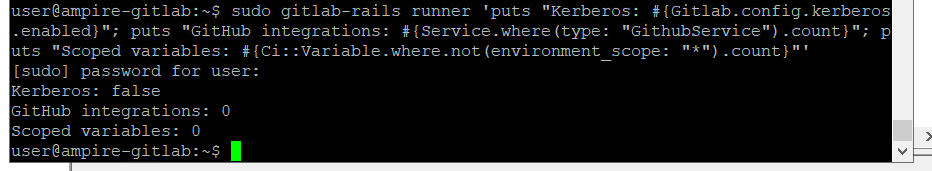{#fig:21 width=16.40cm}

```bash
sudo dpkg -i \
  /home/user/lr3-gitlab-evidence/gitlab-ce_13.10.3-ce.0_amd64.deb
```

Установка завершилась сообщением `Upgrade complete`. Последующий `dpkg-query` подтвердил `gitlab-ce` `13.10.3-ce.0`, а `gitlab-ctl status` показал все 15 служб в состоянии `run`. После обновления повторно проверена доступность восстановленного проекта через веб-интерфейс.

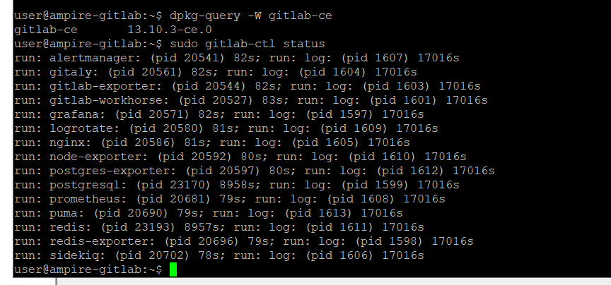{#fig:22 width=16.40cm}

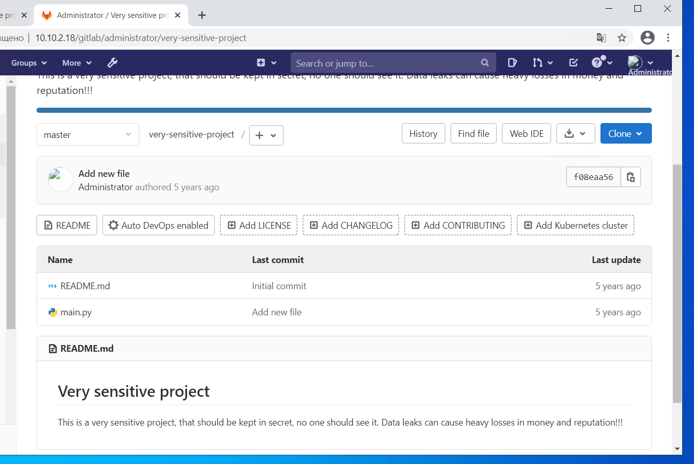{#fig:23 width=16.40cm}

Полный список пользователей после восстановления и обновления содержит `administrator` и внутреннего пользователя `ghost`. Аккаунт нарушителя `Script Kiddie` в списке отсутствует. Служебный `ghost` не удалялся.

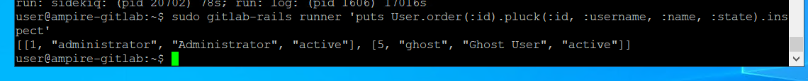{#fig:24 width=16.40cm}

В `Sign-up restrictions` включено `Require admin approval for new sign-ups`. При этом `Sign-up enabled` осталось включенным: регистрация требует одобрения администратора, а не полностью отключена. Изменение сохранено, интерфейс выдал сообщение `Application settings saved successfully`.

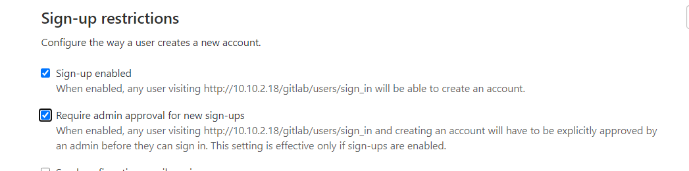{#fig:25 width=16.40cm}

{#fig:26 width=16.40cm}

Завершающая проверка соединений с источником атаки не вывела строк и вернула приглашение командной оболочки. В совокупности с восстановленным проектом и проверкой версии это подтверждает выполнение предусмотренных шагов по GitLab.

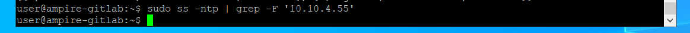{#fig:27 width=16.40cm}

<a id="postgres-remediation"></a>

## PostgreSQL {#postgres-remediation}

На хосте postgrdeb, `10.10.2.26`, обнаружен архив `important_files.tar.gz.aes` размером около 43 МБ. По журналу PostgreSQL сопоставлены операции с таблицей `hacker_table` и запуск программы через `COPY FROM PROGRAM`. В одном из эпизодов команда содержала закодированный Base64-скрипт. Его содержимое декодировано как текст без выполнения.

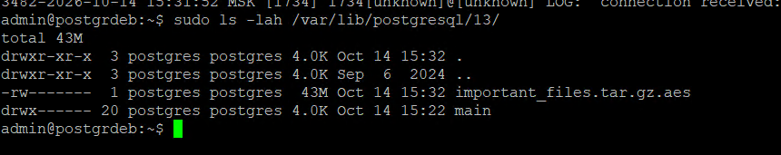{#fig:28 width=16.40cm}

Исходный журнал и зашифрованный архив скопированы в `/home/admin/lr3-evidence`, для файлов вычислены контрольные суммы. Это позволило выполнять восстановление на копии, сохранив исходные материалы. Из текста команды установлены параметры шифрования AES-256-CBC и использование SHA-256 при формировании ключа.

Из-за несовместимости параметров первая попытка дешифрования завершилась `bad decrypt`. После сверки параметров использован явный `-md sha256`, и дальнейшая проверка `gzip -t` вернула код 0. Пароль вводился интерактивно.

```bash
sudo openssl enc -d -aes-256-cbc -md sha256 \
  -in ~/lr3-evidence/important_files.tar.gz.aes \
  -out ~/lr3-evidence/important_files.recovered-v2.tar.gz
sudo gzip -t ~/lr3-evidence/important_files.recovered-v2.tar.gz
echo $?
```

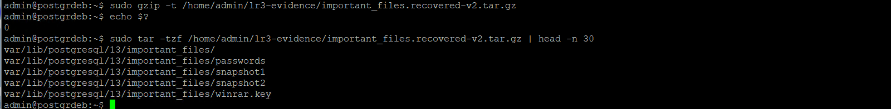{#fig:29 width=16.40cm}

Архив извлечен сначала в отдельный каталог `~/lr3-recovered`. В нем находятся четыре файла: `passwords`, `snapshot1`, `snapshot2` и `winrar.key`.

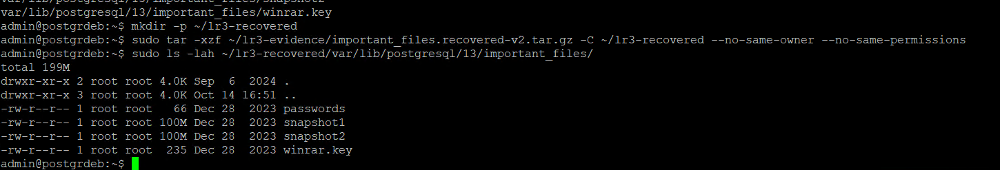{#fig:30 width=16.40cm}

В конфигурации выявлены два условия избыточного доступа: `listen_addresses` имел значение `*`, а в `pg_hba.conf` присутствовала строка `host all all all password`. Последняя разрешала парольную аутентификацию для произвольных баз, ролей и адресов, если клиент достигал сервера.

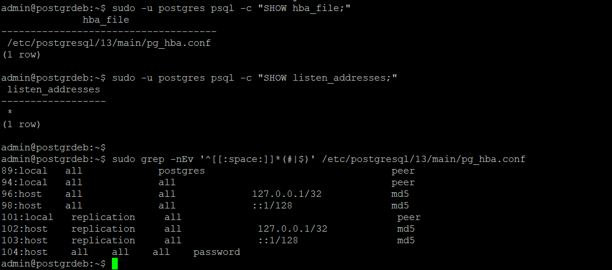{#fig:31 width=16.40cm}

Перед правкой сохранена копия `pg_hba.conf.before`. В `pg_hba.conf` широкая строка закомментирована, локальные правила оставлены. Системное представление `pg_hba_file_rules` не показало ошибок, а `pg_reload_conf` вернул t.

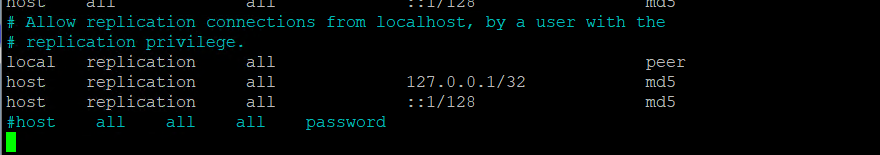{#fig:32 width=16.40cm}

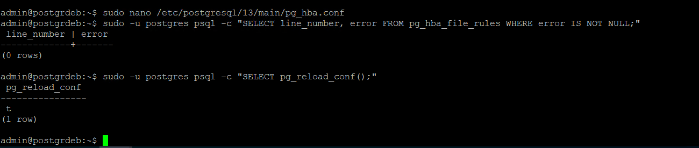{#fig:33 width=16.40cm}

В `pg_stat_activity` обнаружен удаленный сеанс `postgres@template1` с PID 1729 и `client_addr` `10.10.2.254`. Для завершения использован запрос с проверкой PID, роли, базы и адреса. Первый вызов `pg_terminate_backend` вернул t. При повторной проверке подходящих удаленных сеансов не осталось.

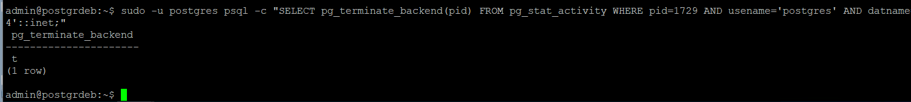{#fig:34 width=16.40cm}

Пароль роли postgres сменен интерактивной метакомандой `\password postgres` в psql. При вводе пароль не отображался. Затем локальный запрос `SELECT current_user, current_database()` вернул postgres и postgres, что подтверждает сохранение локального административного доступа.

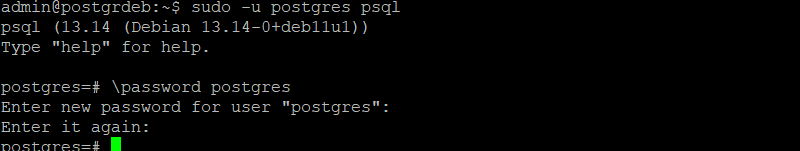{#fig:35 width=16.40cm}

Восстановленный каталог `important_files` возвращен в `/var/lib/postgresql/13/`. Повторный список показал все четыре файла. Проверка `diff -r` между извлеченной копией и целевым каталогом завершилась без различий и вернула код 0. Владельцем извлеченных файлов в выполненной процедуре стал root; исходные метаданные владельца отдельно не подтверждались.

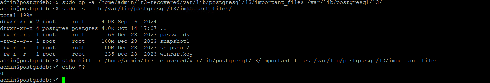{#fig:36 width=16.40cm}

Затем в `postgresql.conf` значение `listen_addresses` изменено с `*` на `localhost`, после чего выполнен перезапуск PostgreSQL. SQL-проверка `SHOW listen_addresses` вернула `localhost`. Эта настройка закрывает удаленное TCP-прослушивание, сохраняя работу локальных клиентов.

```bash
sudo systemctl restart postgresql
sudo -u postgres psql -c "SHOW listen_addresses;"
```

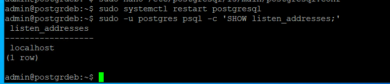{#fig:37 width=16.40cm}

С другой машины стенда, `10.10.4.12`, выполнен `Test-NetConnection` `10.10.2.26` -Port 5432. Узел отвечает на ping, однако `TcpTestSucceeded` имеет значение `False`. Таким образом, отрицательный результат TCP-проверки согласуется с ограничением PostgreSQL, а не только с полной сетевой недоступностью хоста.

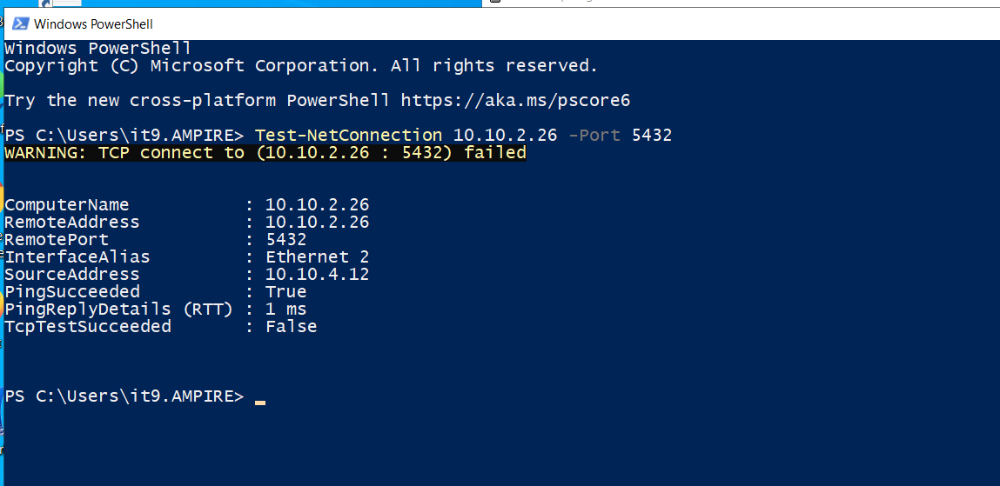{#fig:38 width=16.40cm}

Для PostgreSQL подтверждены восстановление четырех файлов, ограничение HBA, прекращение нежелательного сеанса, смена пароля, переход на `localhost` и закрытие удаленного TCP-доступа. Успех первой обратной оболочки не утверждается: соответствующая запись журнала содержит `Bad file descriptor`.

<a id="incidents"></a>

# Регистрация инцидентов {#incidents}

В Ampire зарегистрированы три карточки по атакованным активам. Для каждой указаны время, источник, целевой ресурс, описание, рекомендации и индикаторы. Автор карточек в интерфейсе — Гусейнов Тагир; на сохраненных кадрах они имеют первоначальный статус «Новый». Последовательность появления карточек отражена также в [приложении А](#appendix-incidents).

Карточка Exchange относится к событию 14.10.2026 около 15:28 и активу `10.10.2.11`. В описание внесены признаки ProxyLogon и Metasploit, в рекомендации — проверка подозрительных файлов и пользователей, ограничение ECP и установка исправления. Упоминание исправления в рекомендации не означает, что его установка была выполнена в этой работе.

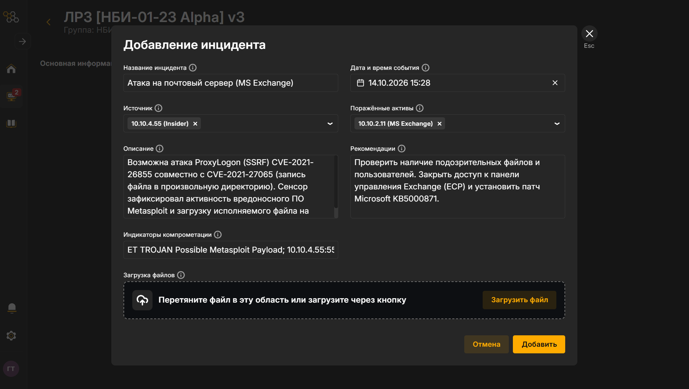{#fig:39 width=16.40cm}

Карточка GitLab относится к 15:29 и активу `10.10.2.18`. В ней указаны обработка изображения ExifTool, подозрительная регистрация и признаки внедрения команд. В рекомендациях отражены обновление и ограничение регистрации; фактически в выполненной конфигурации включено подтверждение новых аккаунтов администратором.

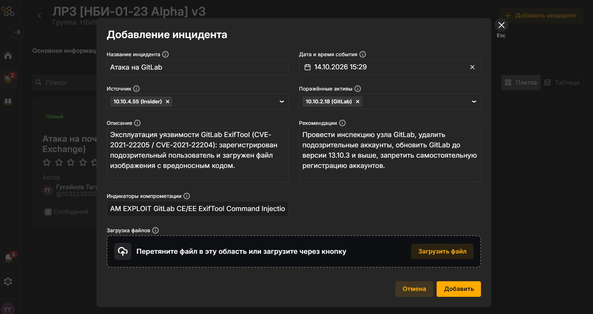{#fig:40 width=16.40cm}

Карточка PostgreSQL относится к 15:31 и активу `10.10.2.26`. Она содержит сведения о `COPY FROM PROGRAM`, загрузке ELF и необходимости ограничить доступ. При интерпретации карточки учитывается уточнение по журналу: обратное подключение является попыткой, успех оболочки по этому эпизоду не доказан. Подтвержденным последствием являются зашифрованные файлы и их последующее восстановление.

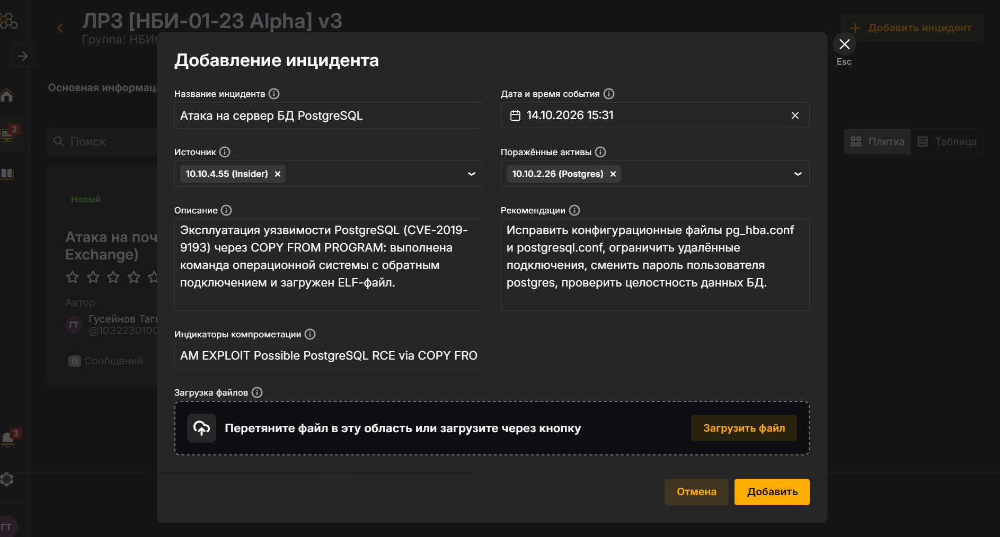{#fig:41 width=16.40cm}

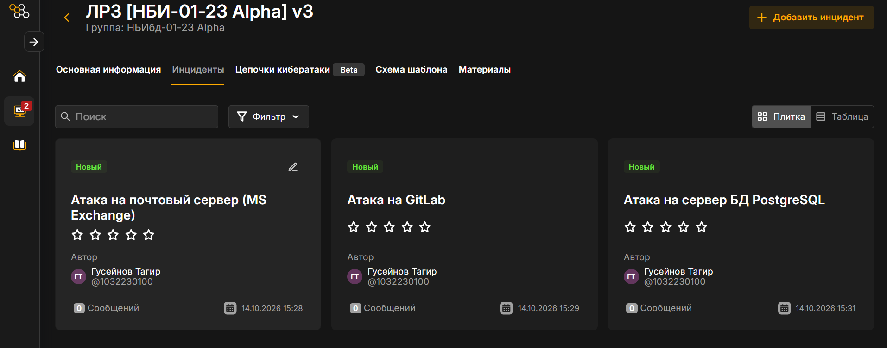{#fig:42 width=16.40cm}

Карточки связывают обнаруженные признаки с активами и мерами реагирования.

<a id="results"></a>

# Результаты и обсуждение {#results}

<a id="asset-results"></a>

## Итоговые результаты по активам {#asset-results}


| Актив | Подтвержденное последствие | Выполненные меры | Проверенный результат |
| :--- | :--- | :--- | :--- |
| Exchange | `hacker` в `Administrators`; два PowerShell-соединения с `10.10.4.55:5556` | ECP `Deny`; удаление `hacker`; завершение атакующего процесса | `hacker` отсутствует; прежние PID и соединения не наблюдаются |
| GitLab | Пустой репозиторий; процесс `/tmp/idMnwN` | Сохранение доказательств; завершение процесса; restore; обновление CE `13.10.3`; admin approval | `README.md` и `main.py` доступны; 15 служб `run`; аккаунт нарушителя отсутствует |
| PostgreSQL | Зашифрованный архив; широкое HBA; `listen_addresses=*` | Дешифрование и возврат файлов; HBA; пароль; завершение сеанса; `localhost` и restart | 4 файла; diff: 0; SHOW: `localhost`; удаленный 5432 недоступен |

: Сопоставление последствий и выполненных мер {#tbl:3}

На итоговом экране «Основная информация» все шесть элементов имеют статус «Устранено»: Proxylogon, Exchange User, GitLab RCE, GitLab deleter, Postgres misconfig и Postgres encrypt. Поля ответственного отображаются как «Не назначено».

{#fig:43 width=16.40cm}

<a id="verified-scope"></a>

## Границы подтвержденного результата {#verified-scope}

Для восстановленных данных имеются самостоятельные проверки: содержимое проекта GitLab проверено через веб-интерфейс, а файлы PostgreSQL сравнены с извлеченной копией. Для ограничений доступа проверены конфигурация HBA, значение `listen_addresses` и отказ удаленного TCP-подключения к 5432. Для ECP подтверждено сохраненное значение `Deny`. Отдельная внешняя HTTP-проверка не выполнялась.

Названия правил IDS описывают признаки и возможный класс атаки. Они не заменяют доказательство результата на хосте. В частности, `Bad file descriptor` ограничивает вывод об успешности первой обратной оболочки PostgreSQL, а присутствие `10.10.2.254` в трафике не является самостоятельным доказательством конкретной схемы NAT.

Удаление пользователя, прекращение найденных соединений и восстановление сервисов соответствуют учебным задачам. Полное исследование всех механизмов закрепления в ОС и подтверждение установленного исправления Exchange в выполненные проверки не входили.

Последовательность атаки восстановлена в [разделе 4.5](#attack-timeline) по IDS, отдельным пакетам и журналам. Хронология связывает сетевые события с подтвержденными последствиями на трех активах. Отдельная цепочка во вкладке «Цепочки кибератаки» Ampire не создавалась.

<a id="conclusion"></a>

# Заключение {#conclusion}

В ходе лабораторной работы мы установили последовательность воздействия на Exchange, GitLab и PostgreSQL, сохранили сетевые и хостовые признаки и зарегистрировали три инцидента. События IDS сопоставлены со временем запуска подозрительного процесса, состоянием учетных записей, содержимым проекта и зашифрованным архивом.

На Exchange ограничен доступ к ECP, удален нелегитимный локальный администратор и устранены наблюдавшиеся атакующие соединения. В GitLab восстановлен репозиторий, выполнено обновление до учебной целевой версии `13.10.3` и включено одобрение регистраций. В PostgreSQL восстановлены четыре файла, изменен пароль и ограничен сетевой доступ; сохранение локальной работы и недоступность удаленного 5432 проверены отдельно.

Итоговый экран тренировки подтверждает статусы «Устранено» для всех трех уязвимостей и трех последствий. Полученный результат показывает значение совместного анализа сетевых событий и состояния хостов: меры реагирования выбирались по конкретным подтвержденным фактам, а успешность восстановления проверялась по данным и работе сервисов.

<a id="appendix-incidents"></a>

# Приложение А Последовательность регистрации инцидентов {#appendix-incidents .unnumbered}

Промежуточные экраны показывают появление карточек в той же тренировке: сначала Exchange, затем GitLab, после чего список дополнен PostgreSQL. Они уточняют последовательность регистрации и дополняют итоговый экран с тремя карточками из раздела 6.

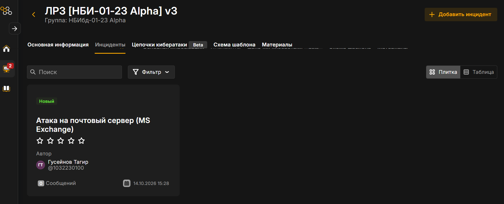{#fig:44 width=16.40cm}

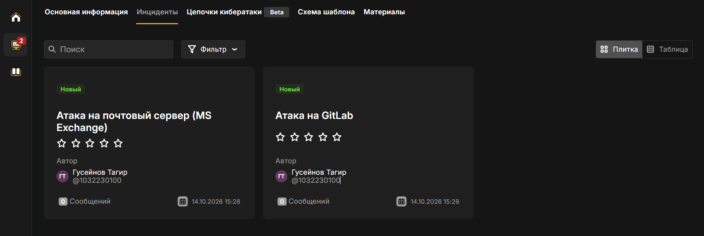{#fig:45 width=16.40cm}

<a id="appendix-files"></a>

# Приложение Б Реестр ключевых файлов расследования {#appendix-files .unnumbered}

Для трех локально сохраненных PCAP вычислена SHA-256. Каждый файл содержит отдельный пакет из события сенсора. Контрольная сумма позволяет проверить неизменность конкретной выгрузки; она не заменяет полный дамп сеанса.

**Б.1.** `IDS_packet_time-2026-10-14T12_31_48.464131Z_ruleid-3202105.pcap`

Размер: 222 байт. Алгоритм: SHA-256.

```text
462f161f2590b8a8a770e74abfc069e1bc0a56ae905bacf5cd5456ed43666ee7
```

**Б.2.** `IDS_packet_time-2026-10-14T12_32_05.359224Z_ruleid-3121915 (1).pcap`

Размер: 1554 байт. Алгоритм: SHA-256.

```text
64a3398e2d61c5bc13dc8eede58d0bf3c7a8ca6e424eec5dff7bf0c17ec60a07
```

**Б.3.** `IDS_packet_time-2026-10-14T12_29_14.264548Z_ruleid-3191163.pcap`

Размер: 1709 байт. Алгоритм: SHA-256.

```text
3aba34a7c1daac5fc58038d9bc47812b0bc987bffd4ef7c934fc78b25bd17987
```

Сохраненный исполняемый файл `/tmp/idMnwN` с GitLab помещен на хосте в lr3-gitlab-evidence/idMnwN.bin. Его SHA-256 зафиксирована при сохранении:

```text
6b84db4d3020ee335aeb837d39316bdd54acc9f24d668f3a59fe84627460e57f
```

Исходные журналы, зашифрованный архив и резервные копии сохранялись до изменений.
